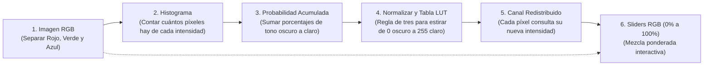
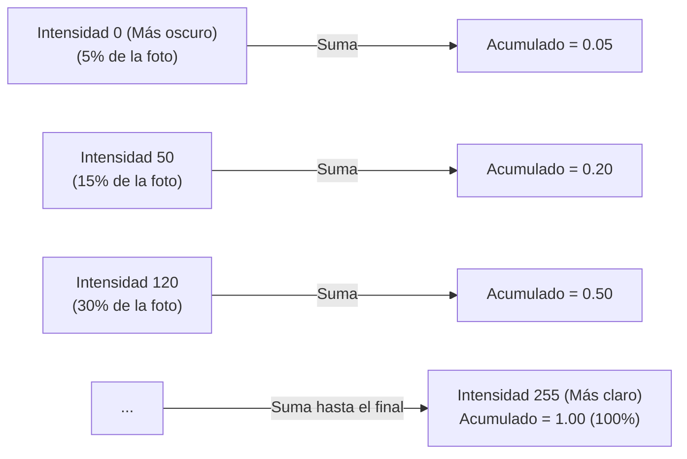

# Guía Visual y Didáctica de Fórmulas y Código RGB
## Proyecto: Redistribución y Ajuste de Histogramas RGB (Inteligencia Artificial - UTA)

Esta guía explica **en cristiano y paso a paso** cada una de las fórmulas del informe y las variables de `main.py`, sin enredos matemáticos y basada en **niveles de intensidad** (del tono más **oscuro 0** al más **claro 255**) en los canales **Rojo (Red)**, **Verde (Green)** y **Azul (Blue)**.

---

## 🧭 Diccionario Rápido: De Símbolos Raros a tu Código Real

| Símbolo en Libros / Informe | ¿Qué es en la vida real? | Variable en tu nuevo `main.py` |
| :---: | :--- | :--- |
| **$k$** o **$r_k$** | Nivel de intensidad (del tono más oscuro 0 al más claro 255) | `nivel_intensidad` |
| **$h(r_k) = n_k$** | Contador: cuántos píxeles tienen esa intensidad | `conteo_intensidades[nivel_intensidad]` |
| **$p(r_k)$** | Porcentaje de la foto con esa intensidad (conteo / total) | `probabilidad_este_nivel` |
| **$CDF(k)$** | Probabilidad acumulada (del tono oscuro al tono claro) | `probabilidad_acumulada[nivel_intensidad]` |
| **$CDF_{\min}$** | La acumulada del tono más oscuro que realmente existe en la foto | `prob_acumulada_minima` |
| **$s_k$** o **$LUT[k]$** | Nueva intensidad estirada de 0 (oscuro) a 255 (claro) | `tabla_conversion_intensidad` |
| **$\alpha$ (alfa)** | Porcentaje del slider convertido a decimal (0.0 a 1.0) | `ajuste_rojo`, `ajuste_verde`, `ajuste_azul` |
| **Canales RGB** | Las 3 matrices de color procesadas independientemente | `canal_rojo`, `canal_verde`, `canal_azul` |

---

## 🗺️ Mapa de Flujo: ¿Qué hace el algoritmo de principio a fin?



---

## 1. El Histograma: Conteo de Intensidades por Canal

### La fórmula descriptiva del informe:
$$\Large \text{Conteo de píxeles}(k) = n_k = \sum_{\text{fila}=0}^{M-1} \sum_{\text{columna}=0}^{N-1} \begin{cases} 
1, & \text{si el píxel en }(\text{fila}, \text{columna}) \text{ tiene intensidad } k \\ 
0, & \text{si tiene cualquier otra intensidad} 
\end{cases}$$

### La fórmula en palabras sencillas:
$$\Large \text{Conteo}(\text{intensidad } k) = \text{Número de píxeles que tienen esa fuerza de color}$$

### ¿Cómo se aplica a los tres canales RGB?
Una imagen a color tiene 3 canales independientes. Por eso el código cuenta las frecuencias de intensidad para cada uno:
* **Canal Rojo (Red):** `hist_rojo_original` (cuántos píxeles hay de rojo oscuro a rojo vivo).
* **Canal Verde (Green):** `hist_verde_original` (cuántos píxeles hay de verde oscuro a verde brillante).
* **Canal Azul (Blue):** `hist_azul_original` (cuántos píxeles hay de azul oscuro a azul claro).

### Diagrama visual del conteo:

```mermaid
graph TD
    subgraph Imagen (Canal de Color)
        P1["Píxel (0,0): Intensidad 50 (Oscuro)"]
        P2["Píxel (0,1): Intensidad 120 (Medio)"]
        P3["Píxel (0,2): Intensidad 50 (Oscuro)"]
        P4["Píxel (1,0): Intensidad 200 (Claro)"]
    end

    subgraph Cajitas de Conteo (Arreglo de 256 casilleros)
        C50["conteo_intensidades[50] = 2 píxeles"]
        C120["conteo_intensidades[120] = 1 píxel"]
        C200["conteo_intensidades[200] = 1 píxel"]
    end

    P1 -->|Suma 1| C50
    P2 -->|Suma 1| C120
    P3 -->|Suma 1| C50
    P4 -->|Suma 1| C200
```

### Código exacto en tu `main.py`:
```python
alto_imagen, ancho_imagen = canal_color.shape
total_pixeles = alto_imagen * ancho_imagen

# 1. Crear 256 casilleros vacíos (uno por cada nivel de intensidad)
conteo_intensidades = np.zeros(256, dtype=np.float64)
for fila in range(alto_imagen):
    for columna in range(ancho_imagen):
        nivel_intensidad_pixel = canal_color[fila, columna]
        conteo_intensidades[nivel_intensidad_pixel] += 1.0
```

---

## 2. La Probabilidad Acumulada: CDF (Cumulative Distribution Function)

### La fórmula descriptiva del informe:
$$\Large \text{CDF}(k) = \text{Probabilidad Acumulada}(k) = p(0) + p(1) + p(2) + \dots + p(k)$$
$$\Large \text{CDF}(255) = 1.0 \quad (100\% \text{ de la imagen})$$

### ¿Qué significa en la vida cotidiana?
En lugar de preguntar *"¿cuántos píxeles valen exactamente 100?"*, preguntamos: **"¿Qué porcentaje de la foto tiene tonos iguales o más oscuros que 100?"**.
* Vas acumulando porcentajes desde el tono más oscuro ($0$).
* Al llegar al tono más claro ($255$), la suma siempre llega exactamente a **1.00 (el 100% de los píxeles)**.



### Código exacto en tu `main.py`:
```python
# 2. Calcular la probabilidad acumulada (del tono mas oscuro al mas claro)
probabilidad_acumulada = np.zeros(256, dtype=np.float64)
suma_acumulada = 0.0
for nivel_intensidad in range(256):
    probabilidad_este_nivel = conteo_intensidades[nivel_intensidad] / total_pixeles
    suma_acumulada += probabilidad_este_nivel
    probabilidad_acumulada[nivel_intensidad] = suma_acumulada
```

---

## 3. El Estiramiento: Mapear del Tono más Oscuro (0) al más Claro (255)

### La fórmula descriptiva del informe:
$$\Large \text{Nueva Intensidad}(k) = \text{redondear}\left( \frac{\text{CDF}(k) - \text{CDF}_{\min}}{1.0 - \text{CDF}_{\min}} \times 255 \right)$$

### ¿Por qué existe esta fórmula?
Si una imagen tiene poco contraste, sus colores están amontonados (por ejemplo, entre 60 y 140). Los tonos más oscuros (0 a 59) y los tonos más claros (141 a 255) están desperdiciados.
Esta fórmula es una **regla de tres** que estira la distribución:
1. **Restar `CDF_min`:** El tono más oscuro que realmente aparece en la foto se fuerza a comenzar en **0** (negro puro).
2. **Dividir para `(1.0 - CDF_min)`:** Normaliza el rango útil entre el tono más oscuro y el más claro en la escala unitaria $[0.0, 1.0]$.
3. **Multiplicar por `255`:** Escala al tono más claro disponible en pantallas ($255$).
4. **`round(...)`:** Redondea al entero más cercano, porque los píxeles digitales son números enteros discretos.

### Código exacto en tu `main.py`:
```python
# 3. Encontrar el nivel mas oscuro que realmente existe en la foto
niveles_con_pixeles = np.where(conteo_intensidades > 0)[0]
prob_acumulada_minima = probabilidad_acumulada[niveles_con_pixeles[0]]
rango_probabilidad_util = 1.0 - prob_acumulada_minima if (1.0 - prob_acumulada_minima) > 0 else 1.0

# 4. Crear la tabla de conversion directa (LUT)
tabla_conversion_intensidad = np.zeros(256, dtype=np.uint8)
for nivel_intensidad in niveles_con_pixeles:
    nueva_intensidad_calculada = ((probabilidad_acumulada[nivel_intensidad] - prob_acumulada_minima) / rango_probabilidad_util) * 255.0
    tabla_conversion_intensidad[nivel_intensidad] = np.uint8(np.round(nueva_intensidad_calculada))

# 5. Asignar los nuevos niveles de intensidad a cada pixel
for fila in range(alto_imagen):
    for columna in range(ancho_imagen):
        canal_redistribuido[fila, columna] = tabla_conversion_intensidad[canal_color[fila, columna]]
```

---

## 4. Los Sliders RGB: Mezcla Ponderada entre Original y Redistribuido

### La fórmula descriptiva:
$$\Large \text{Píxel Final} = (1 - \text{Ajuste}) \times \text{Píxel Original} + \text{Ajuste} \times \text{Píxel Redistribuido}$$

### ¿Cómo se aplica a cada canal RGB?
* **Canal Rojo:** $\text{Rojo}_{\text{final}} = \text{redondear}\Big( (1 - \text{Ajuste}_R) \cdot \text{Rojo}_{\text{orig}} + \text{Ajuste}_R \cdot \text{Rojo}_{\text{redist}} \Big)$
* **Canal Verde:** $\text{Verde}_{\text{final}} = \text{redondear}\Big( (1 - \text{Ajuste}_G) \cdot \text{Verde}_{\text{orig}} + \text{Ajuste}_G \cdot \text{Verde}_{\text{redist}} \Big)$
* **Canal Azul:** $\text{Azul}_{\text{final}} = \text{redondear}\Big( (1 - \text{Ajuste}_B) \cdot \text{Azul}_{\text{orig}} + \text{Ajuste}_B \cdot \text{Azul}_{\text{redist}} \Big)$

### Ejemplo con números reales:
Imagina un píxel que originalmente tenía intensidad **$80$** (tono oscuro apagado), y tras la redistribución completa le corresponde **$190$** (tono claro y nítido):
* **Slider en 0% (ajuste = 0.0):** $(1 - 0.0) \times 80 + 0.0 \times 190 = \mathbf{80}$ (Foto original intacta).
* **Slider en 50% (ajuste = 0.5):** $(0.5) \times 80 + (0.5) \times 190 = 40 + 95 = \mathbf{135}$ (Mezcla media suave).
* **Slider en 100% (ajuste = 1.0):** $(0.0) \times 80 + 1.0 \times 190 = \mathbf{190}$ (Efecto total estirado).

---

## 🎓 Resumen para Defender en Clase ante el Docente

Si el docente te pregunta: **"¿Qué hace tu algoritmo paso a paso?"**, responde:

1. **Separación RGB:** Descompongo la imagen en sus 3 canales de color: `canal_rojo`, `canal_verde` y `canal_azul`.
2. **Histograma:** Con dos bucles `for` cuento cuántos píxeles hay de cada **nivel de intensidad**, desde el tono más oscuro ($0$) hasta el más claro ($255$), almacenándolos en `conteo_intensidades`.
3. **Probabilidad Acumulada (CDF):** Acumulo progresivamente los porcentajes desde el tono más oscuro al más claro en `probabilidad_acumulada`, llegando al $100\%$ ($1.00$).
4. **Normalización (LUT):** Tomo el tono más oscuro presente en la foto (`prob_acumulada_minima`) y estiro las intensidades hacia los extremos $0$ (negro) y $255$ (máxima intensidad), guardándolas en `tabla_conversion_intensidad`.
5. **Calibración con Sliders:** Mediante la interpolación ponderada $(1 - \text{ajuste}) \cdot \text{orig} + \text{ajuste} \cdot \text{redist}$, permito regular el efecto de $0\%$ a $100\%$ de forma desacoplada para cada color.
